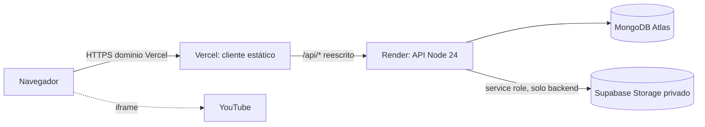

# Despliegue en producción

Copérnico Academy se despliega en cuatro piezas:

| Pieza | Servicio | Qué contiene |
|---|---|---|
| Cliente (React + Vite) | Vercel | Build estático de `client/`. Reenvía `/api/*` a la API. |
| API (Express, Node 24) | Render | Código de la raíz, definido en `render.yaml`. |
| Base de datos | MongoDB Atlas | Replica set (las transacciones de citas lo necesitan). |
| Archivos privados | Supabase Storage | Avatares, documentos y materiales en un bucket privado. |

Los vídeos no se alojan: se reproducen desde YouTube.

## Antes de empezar

- El historial de git anterior contiene credenciales antiguas. **Rota** las de MongoDB, `JWT_SECRET` y Supabase antes de publicar; no reutilices valores de un `.env` local.
- El repositorio debe estar en GitHub: Render y Vercel despliegan desde ahí.
- Los cambios deben estar en la rama que despliegas (normalmente `main`, tras aprobar el merge).

## 1. MongoDB Atlas

1. Crea un cluster. M0 sirve para el piloto y ya es replica set.
2. *Database Access*: crea un usuario dedicado con permiso `readWrite` solo sobre la base `copernico`. No uses el usuario administrador.
3. *Network Access*: el plan free de Render no tiene IP fija, así que hay que permitir `0.0.0.0/0`. Compénsalo con un usuario dedicado y una contraseña fuerte. Con un plan de pago de Render, permite solo su IP saliente.
4. *Connect → Drivers*: copia la cadena `mongodb+srv://…`, sustituye la contraseña (codifica los caracteres especiales en URL) y añade la base: `…mongodb.net/copernico?retryWrites=true&w=majority`. Ese valor es `MONGODB_URI`.

## 2. Supabase Storage

1. Crea un proyecto. En *Storage → New bucket* crea `copernico-private` con **Public desactivado**.
2. En *Project Settings → API* copia la URL (`SUPABASE_URL`) y la clave `service_role` (`SUPABASE_SERVICE_ROLE_KEY`).
3. Esa clave da acceso total al proyecto. Configúrala solo en Render: nunca en Vercel ni en variables `VITE_*`, que acaban en el navegador.
4. Si el proyecto solo ofrece claves `sb_secret_…` y no la `service_role`, comprueba las subidas en el paso 6 antes de dar el despliegue por bueno. El cliente de almacenamiento envía la clave también como `Authorization: Bearer`, y no está verificado que Storage acepte esa forma con claves nuevas.

## 3. Render (API)

1. *New → Blueprint*, elige el repositorio y la rama. Render lee `render.yaml` y propone el servicio `copernico-api`.
2. Completa las variables que pide:
   - `MONGODB_URI`: cadena del paso 1.
   - `FRONTEND_URL`: origen de Vercel, p. ej. `https://copernico.vercel.app`, sin barra final. Si aún no existe, pon un valor provisional y corrígelo en el paso 5.
   - `SUPABASE_URL` y `SUPABASE_SERVICE_ROLE_KEY`: del paso 2.
   - `JWT_SECRET`: se genera solo (256 bits). No lo cambies sin motivo: cierra todas las sesiones.
3. Crea el servicio y espera a *Live*. El health check es `/api/health/ready`, que responde 503 si no hay conexión con Atlas.
4. Anota la URL pública (`https://copernico-api.onrender.com` u otra si el nombre ya está ocupado). Si no coincide con la de `client/vercel.json`, corrígela en el paso 4.

`render.yaml` ya fija `NODE_VERSION=24`, `NODE_ENV=production` y `TRUST_PROXY=2`. No definas `PORT`: Render lo inyecta.

El build instala primero las dependencias de compilación: `npm ci --include=dev && npm run build && npm prune --omit=dev`. El arranque es `npm start`, que ejecuta `node dist/src/index.js`. No omitas las dependencias de desarrollo antes de compilar: incluyen TypeScript. La imagen de Docker también compila en una etapa independiente y copia el artefacto y las dependencias de ejecución a la imagen final.

## 4. Vercel (cliente)

1. *Add New → Project* e importa el mismo repositorio.
2. Pon **Root Directory = `client`**. Vercel detecta Vite; instalación y build están en `client/vercel.json`.
3. **No definas `VITE_API_URL`**. El cliente llama a `/api` del mismo origen y `client/vercel.json` lo reenvía a Render.
4. Revisa `client/vercel.json`: el `destination` de `/api/:path*` debe ser la URL de Render del paso 3. Si cambia, corrígelo y haz commit antes de desplegar.
5. Despliega y anota el dominio `https://<proyecto>.vercel.app`.

## 5. Cerrar la configuración de origen

1. En Render → *Environment*, pon `FRONTEND_URL` con el dominio exacto de Vercel. Si tienes dominio propio, sepáralos por comas: `https://copernico.vercel.app,https://academia.ejemplo.com`.
2. Guarda. Render reinicia el servicio.

La API rechaza con `403 FORBIDDEN_ORIGIN` cualquier POST, PUT, PATCH o DELETE cuyo `Origin` no esté en `FRONTEND_URL`. CORS usa la misma lista.

## 6. Comprobaciones tras el despliegue

Hazlas contra el dominio de Vercel, no contra Render directamente.

- [ ] `https://<render>/api/health` responde 200 y `/api/health/ready` responde 200 (conexión con Atlas).
- [ ] `https://<proyecto>.vercel.app` carga, y recargar una ruta interna como `/login` no da 404.
- [ ] Al iniciar sesión, la cookie de sesión aparece en DevTools como `HttpOnly`, `Secure` y `SameSite=Lax`, y sobrevive a recargar la página.
- [ ] Las respuestas de `/api/*` incluyen `Cache-Control: no-store`.
- [ ] Límite de inicio de sesión: 20 intentos fallidos en 15 minutos desde un mismo equipo devuelven `429 RATE_LIMITED`. Desde otra red (p. ej. el móvil) el login debe seguir funcionando. Si el contador es compartido por todos, `TRUST_PROXY` está mal configurado.
- [ ] Subida de un documento de ~9 MB desde el dominio de Vercel. Si responde `413`, la reescritura de Vercel limita el cuerpo y las subidas grandes necesitan subida directa a Supabase con URL firmada (no implementado).
- [ ] Descarga de un documento y de un material: el enlace firmado abre el archivo.
- [ ] Una lección con vídeo de YouTube reproduce y guarda el progreso.
- [ ] Reservar una cita (requiere un curso publicado; ver siguiente sección).

## 7. Datos iniciales

- **No hay pantalla para crear cursos todavía.** Para reservar citas, inserta en la colección `courses` (Atlas → Data Explorer) al menos un documento con `title`, `instructor` (ObjectId de un usuario con `role: "tutor"`), `isPublished: true` y `level` (`beginner`, `intermediate` o `advanced`).
- Los usuarios se crean con el registro. Para hacer administrador a alguien, cambia su `role` a `"admin"` en la colección `users`.
- `npm run migrate:advisors` y `npm run migrate:courses` ejecutan scripts compilados de `dist/scripts/`: requieren haber ejecutado `npm run build`. Solo sirven para datos de la versión anterior. Haz una copia de seguridad de Atlas antes de ejecutarlos y no los ejecutes sobre una base nueva.

## 8. Operación

- **Plan free de Render:** el servicio se duerme tras ~15 minutos sin tráfico y la primera petición puede tardar un minuto. Un plan de pago lo evita.
- **Límites de peticiones en memoria:** cada proceso cuenta por separado. Mantén una sola instancia hasta mover los limitadores a un almacén compartido.
- **Logs:** Render → *Logs*.
- **Rotación:** cambiar `JWT_SECRET` cierra todas las sesiones. Si cambias la clave de Supabase o la contraseña de Atlas, actualiza Render y reinicia.

## Problemas frecuentes

| Síntoma | Causa probable |
|---|---|
| `403 FORBIDDEN_ORIGIN` al guardar algo | `FRONTEND_URL` no coincide con el dominio de Vercel. |
| `503 STORAGE_NOT_CONFIGURED` al subir | Faltan `SUPABASE_URL` o `SUPABASE_SERVICE_ROLE_KEY` en Render. |
| `/api/health/ready` responde 503 | Usuario, contraseña o acceso de red de Atlas incorrectos. |
| `/api/*` responde 404 desde Vercel | El `destination` de `client/vercel.json` no apunta a Render. |
| La sesión no persiste | Se accede sin HTTPS o la cookie no llega por el dominio de Vercel. Revisa el paso 6. |
| Todas las sesiones caen tras un despliegue | `JWT_SECRET` cambió. |
| Subidas con error 500 | Clave de Supabase incompatible (ver paso 2.4). |
